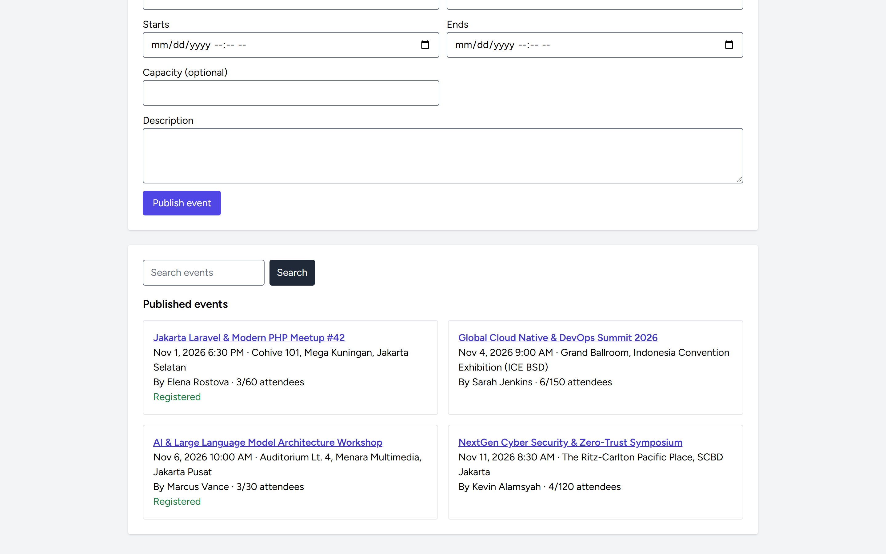
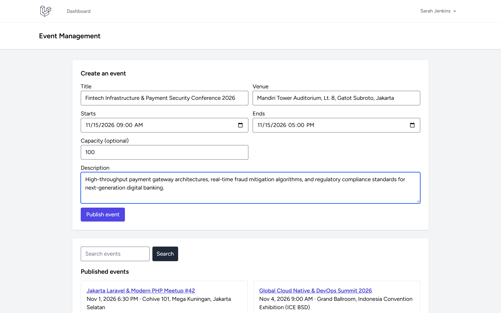
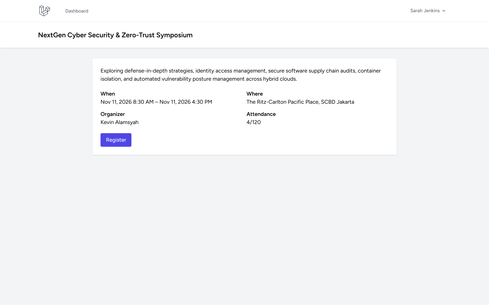
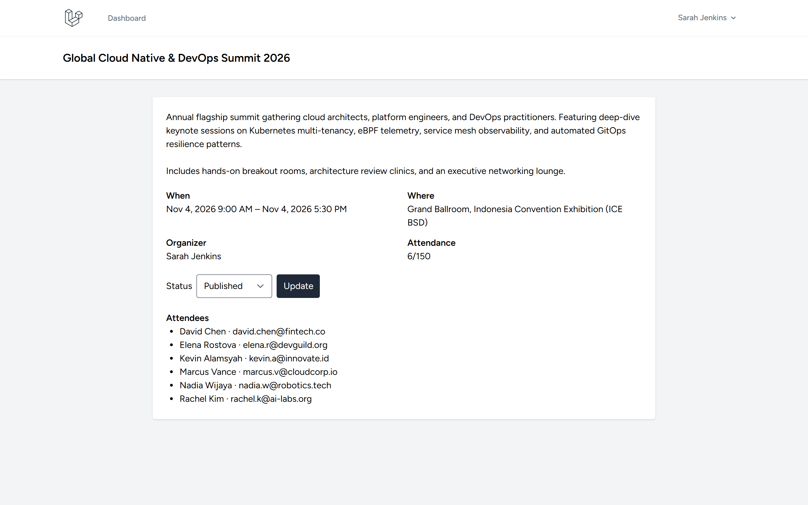

# Event Management Laravel

Authenticated event publishing and attendee registration with persisted attendance counts, organizer-controlled cancellation/completion, and capacity enforcement. No seeded users or fabricated events.

## Screenshots

| Tampilan | Preview |
|---|---|
| **Katalog Event & Pencarian**<br>Daftar acara publikasi, tanggal pelaksanaan, lokasi venue, kuota peserta, dan penanda status RSVP terdaftar |  |
| **Formulir Publikasi & Penjadwalan Event**<br>Form interaktif pembuatan event baru dengan validasi tanggal, kuota kapasitas, dan deskripsi detail |  |
| **Detail Event & Pendaftaran RSVP**<br>Halaman informasi lengkap acara, rincian jadwal operasional, data penyelenggara, dan aksi registrasi peserta |  |
| **Manajemen Penyelenggara & Daftar Peserta**<br>Panel kontrol organizer untuk pembaruan status acara (Published/Cancelled/Completed) dan roster nama peserta terdaftar |  |

---

## Local setup (Windows)

```powershell
Copy-Item .env.example .env
php C:/Users/wondr/.config/herd-lite/bin/composer.phar install
npm install
php artisan key:generate
php artisan migrate --seed
npm run build
php artisan serve
```

Register to publish events or RSVP. Organizers may see the attendee list and change their event status; other users may only view published events. Duplicate registrations are prevented by a database unique constraint. Capacity checks execute inside a transaction with a row lock; use a database engine with row-level locking (e.g. PostgreSQL/MySQL) for reliable concurrent capacity enforcement. The local SQLite setup is for development/testing.

Events have title, description, venue, start/end timestamps, optional capacity, organizer and status. Published event search and listing use persisted data. No payment processing, waitlist, email notifications, calendar integration, or organizer role management is included.

## Verification

```powershell
php artisan migrate:fresh --seed --no-interaction
php artisan view:clear
php artisan view:cache
php artisan test --compact
npm run build
php C:/Users/wondr/.config/herd-lite/bin/composer.phar validate --no-check-publish
php C:/Users/wondr/.config/herd-lite/bin/composer.phar audit
npm audit --omit=dev
```

Keep `.env`, personal data, dependencies, SQLite databases, and build output out of Git.
